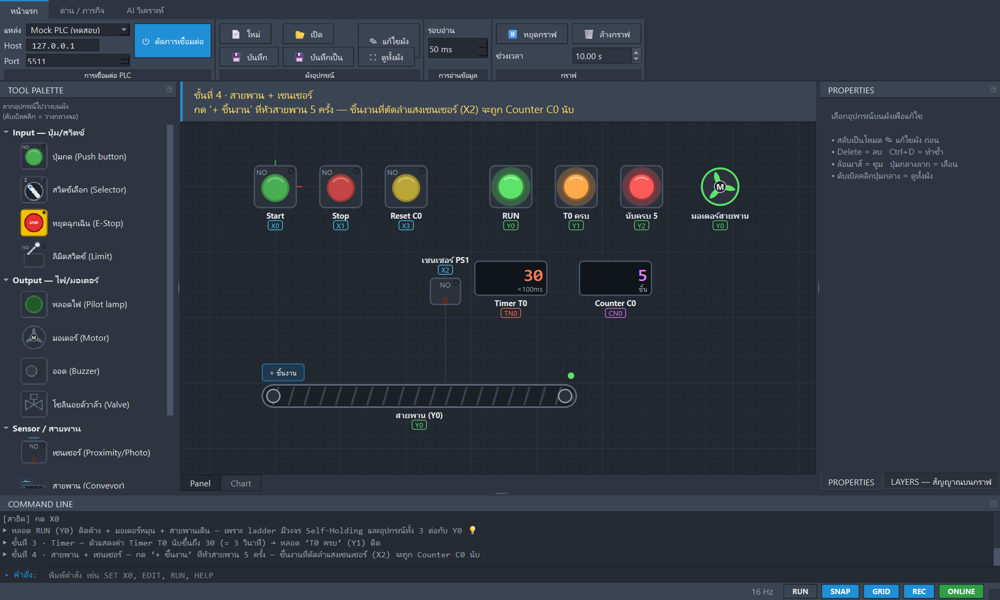

# PLC Trainer — Educational PLC Simulation Game

**Phase 1 (ทำเสร็จแล้ว):** เชื่อมต่อ PLC, ผังอุปกรณ์แบบลากวางพร้อมกำหนด I/O เอง และกราฟเรียลไทม์ ใช้ธีมมืดแบบ AutoCAD

| ส่วน | หน้าที่ |
|---|---|
| Ribbon (บน) | เลือกแหล่ง PLC (GX Simulator3 / PLC ในตัว / Mock), เชื่อมต่อ, จัดการผัง (ใหม่/เปิด/บันทึก/✎ แก้ไขผัง), ตั้งรอบการอ่าน และควบคุมกราฟ |
| Tool Palette (ซ้าย) | อุปกรณ์ 5 หมวด ได้แก่ Input (ปุ่มกด, Selector, E-Stop, Limit, Overload), Output (หลอดไฟ, มอเตอร์, คอนแทคเตอร์, Buzzer, Valve, ไฟจราจร), Sensor/สายพาน, นิวแมติก/กระบวนการ (กระบอกสูบ + วาล์ว 5/2, ถังน้ำ) และแสดงค่า/ตั้งค่า (Display, 7-Segment, ตัวตั้งค่า D) ใช้ลากไปวางบนผัง · อุปกรณ์บางชนิดมีหลาย address (เช่น โซลินอยด์ + รีดสวิตช์ a0/a1) |
| Panel (กลาง) | ผังอุปกรณ์บนพื้นกริด ซูมด้วยล้อเมาส์ เลื่อนด้วยปุ่มกลาง ดับเบิลคลิกปุ่มกลาง = ดูทั้งผัง |
| Chart (กลาง) | Timing Diagram 0/1 กับกราฟ Trend ของ T/C มี crosshair บอกค่าที่ตำแหน่งเมาส์ |
| Ladder (กลาง) | เขียน ladder ในโปรแกรม ส่งลง PLC ในตัว และดูสถานะสด |
| Properties (ขวา) | แก้ชื่อ, **Address I/O**, NO/NC, สี, หน่วย ของอุปกรณ์ที่เลือก และตรวจ address ให้ทันที (ผิด = กรอบแดง, Input ซ้ำ = เตือน) |
| Layers (ขวา) | เลือกว่าจะแสดงสัญญาณไหนบนกราฟ (สร้างรายการจาก address ในผังอัตโนมัติ) |
| Command line (ล่าง) | `SET X0`, `RST X0`, `PULSE X2`, `EDIT`, `RUN`, `U`/`REDO`, `SPLIT`, `BIG`, `ZOOM E`, `PAUSE`, `WINDOW 20`, `HELP` |
| Status bar | อัตรา Hz, EDIT/RUN, SNAP, GRID, SPLIT (แบ่งจอ), BIG (ตัวใหญ่), REC, ONLINE/OFFLINE |

**ใช้งานสะดวกขึ้น**
- **Ctrl+Z / Ctrl+Y** ย้อนกลับหรือทำซ้ำการจัดผัง
- **คลิกขวา** ที่อุปกรณ์เพื่อแก้ address/ชื่อ/คีย์ลัด, ทำซ้ำ, ลบ, จัดลำดับ หรือคลิกขวาที่พื้นว่างเพื่อวางอุปกรณ์
- **คีย์ลัด:** อุปกรณ์ Input มีป้ายสีขาวบอกคีย์ (1, 2, 3…) โหมดใช้งานกดคีย์นั้นบนคีย์บอร์ด = กดอุปกรณ์ ใช้ได้แม้คีย์บอร์ดเป็นภาษาไทย
- **ชี้เมาส์ค้าง** ที่อุปกรณ์เพื่อดู address ค่าปัจจุบัน และเวลาที่เปลี่ยนล่าสุด
- **◫ แบ่งจอ** แสดงผังและกราฟพร้อมกัน และ **🔍 ตัวใหญ่** สำหรับฉายโปรเจกเตอร์ โปรแกรมจำการตั้งค่านี้ไว้ใน `panels/ui_state.json`



## เปิดโปรแกรม
มีไอคอนบน Desktop 2 อัน:
- **PLC Trainer** ใช้งานปกติ
- **PLC Trainer (สาธิตวิธีใช้)** โปรแกรมกดปุ่มให้ดูเองทีละขั้น (ประมาณ 45 วินาที) และมีภาพแต่ละขั้นอยู่ใน `docs/images/demo_*.png`

## วิธีใช้งาน (สรุป)
1. **เชื่อมต่อ:** ที่ Ribbon เลือกแหล่ง PLC แล้วกด **เชื่อมต่อ** ถ้าสำเร็จ ไฟ ONLINE ขวาล่างจะเป็นสีเขียว
2. **จัดผัง:** กด **✎ แก้ไขผัง** แล้วลากอุปกรณ์จาก TOOL PALETTE มาวาง (หรือดับเบิลคลิก) จากนั้นคลิกอุปกรณ์แล้วตั้ง **Address** ใน PROPERTIES ให้ตรงกับ ladder
   - ย้ายได้ด้วยการลาก, Delete = ลบ, Ctrl+D = ทำซ้ำ, SNAP ทีละ 20 px
   - Output หลายชิ้นใช้ address เดียวกันได้ (เช่น หลอด RUN, มอเตอร์ และสายพาน ใช้ Y0 ทั้งหมด) แต่ Input ห้ามซ้ำกัน
3. **ใช้งาน:** กด **▶ ใช้งาน** แล้วคลิกที่อุปกรณ์
   - ปุ่มกดและ Limit switch = กดค้าง ส่วน Selector และ E-Stop = กดแล้วค้าง (ตั้ง NO/NC ได้)
   - สายพานเดินเมื่อ address ON กด **+ ชิ้นงาน** เพื่อปล่อยชิ้นงาน เมื่อชิ้นงานตัดลำแสงของเซนเซอร์ เซนเซอร์จะ ON
   - ผังตัวอย่าง: `panels/cylinder_AplusBplus`, `tank`, `star_delta`, `traffic` (สร้างใหม่ได้ด้วย `tools/make_example_panels.py`)
   - ไฟเล็กมุมขวาบนของอุปกรณ์ Input = ค่าที่ PLC อ่านได้จริง
4. **บันทึกผัง:** 💾 บันทึกเป็นไฟล์ `.plcpanel` ในโฟลเดอร์ `panels/` และเมื่อเปิดโปรแกรมครั้งถัดไปจะเปิดผังล่าสุดให้เอง (ผังตัวอย่างคือ `panels/default.plcpanel`)
5. **ดูกราฟ:** แท็บ **Chart** ด้านล่าง กด **หยุดกราฟ** แล้วเลื่อนเมาส์เพื่ออ่านค่าย้อนหลัง และเลือกสัญญาณได้ที่แผง LAYERS

## ติดตั้งและรัน (ทุกอย่างอยู่ในโฟลเดอร์นี้)
```powershell
python -m venv .venv
.\.venv\Scripts\pip install -r requirements.txt
.\.venv\Scripts\python -m plc_game.main --backend mock --connect   # ทดสอบโดยไม่ต้องมี PLC
.\.venv\Scripts\python -m plc_game.main --backend soft --connect   # PLC ในตัว (รัน ladder ที่วาดเอง)
.\.venv\Scripts\python -m plc_game.main --backend slmp            # ต่อกับ GX Simulator3
.\.venv\Scripts\python -m pytest                                  # รันชุดทดสอบ
```

## ต่อกับ GX Simulator3 (ทดสอบจริงแล้ว เมื่อ 16/11/2569 กับ GX Works3 1.110Q)
> ⚠️ GX Simulator3 **ไม่ตอบ SLMP ถ้าโปรเจกต์เป็น FX5U** ต้องใช้โปรเจกต์ **RCPU (R04CPU)**
> ถ้ามีโปรเจกต์ FX5U อยู่แล้ว ใช้ Project → Change Module Type/Operation Mode → RCPU / R04 ได้เลย โดย ladder เดิมยังอยู่ครบ

1. ไปที่ Navigation → Parameter → R04CPU → **Module Parameter** → Own Node Settings แล้วตั้ง
   **Enable/Disable Online Change = "Enable All (SLMP)"** จากนั้นกด Apply
2. กด **F4** เพื่อ Convert แล้วไปที่ **Debug → Simulation → Start Simulation**
3. เปิด PLC Trainer เลือก "GX Simulator3 (SLMP)" ตั้ง `127.0.0.1:5511` แล้วกด **เชื่อมต่อ**
4. ถ้าอยากเช็กการเชื่อมต่อแบบเร็วๆ ให้รัน `.\.venv\Scripts\python tools\probe_gx.py 5511`
5. ถ้าอยากดูการสาธิตกับ GX จริง ให้รัน `.\.venv\Scripts\python -m plc_game.main --demo --backend slmp`

ตัวอย่างโปรเจกต์อยู่ใน `gx_projects/` คือ `test_fx5u.gx3` (ต้นฉบับ) และ `test_r04.gx3` (ไฟล์ที่ใช้กับ simulator)
เลข X/Y ของ iQ-R เป็นฐาน 16 (`xy_base: 16` ใน `config.yaml`) แต่ X0–X7 จะชื่อเหมือนกันทั้งสองแบบ

## Mock PLC (ladder ที่ฝังไว้สำหรับทดสอบ)
- X0 = Start, X1 = Stop → Y0 ค้างแบบ self-holding
- Y0 ติด → T0 นับ 3 วินาที → Y1
- X2 นับขอบขาขึ้น → C0 ถึง 5 → Y2 และ X3 = รีเซ็ต C0

## เขียน ladder ในโปรแกรม (PLC ในตัว ไม่ต้องมี GX Works3)
1. เลือกแหล่ง PLC เป็น **PLC ในตัว (รัน ladder)** แล้วกด **เชื่อมต่อ**
2. เปิดด่านหรือผัง แล้วไปที่แท็บ **Ladder** (หรือพิมพ์ `DRAW`)
3. วาด ladder แล้วกด **F4** โปรแกรมจะตรวจก่อน ถ้าผ่านจะล้าง M/T/C/D แล้ว RUN ถ้าไม่ผ่านจะบอก rung ที่ต้องแก้
4. กด **▶ ตรวจคำตอบ** (ถ้าแก้ ladder แล้วยังไม่ส่ง โปรแกรมจะเตือนให้กด F4 ก่อน)

| ปุ่ม | ทำอะไร |
|---|---|
| F5 / F6 | หน้าสัมผัส NO / NC (Shift = ต่อขนาน, Ctrl = แทรกก่อน) |
| F7 / Shift+F7 | คอยล์ / output ที่มีหน้าสัมผัสของตัวเอง |
| F8 | คำสั่ง เช่น `MOV K10 D0`, `SET M0`, `RST C0` |
| Enter หรือ F2 | แก้ชิ้นที่เลือก (พิมพ์คำสั่งตรง ๆ เช่น `X0`, `ANI X1`, `OUT T0 K30` ก็ได้) |
| Insert / Shift+Insert | แทรก rung ใต้ / เหนือ |
| Delete / Ctrl+Delete | ลบชิ้นที่เลือก / ทั้ง rung |
| Alt+↑↓ | ย้าย rung |
| Ctrl+Z / Y / C / X / V | ย้อนกลับ / ทำซ้ำ / คัดลอก / ตัด / วาง rung |
| `;` | คอมเมนต์ของ rung |

- **คำสั่งที่รองรับ:** หน้าสัมผัสทุกแบบ, เปรียบเทียบ 16/32 บิต (เช่น LDD>=), OUT/SET/RST/PLS/PLF/FF, T/C/ST, MOV/FMOV/BMOV, INC/DEC, + − × ÷, BCD/BIN, 32 บิต DMOV/DINC/DDEC/D+ D- D* D/ /DBCD/DBIN (ใช้ D, W, SD 2 ตัวติดกัน), กลุ่มบิต K1–K8 เช่น BIN K4X0 D0, CJ/CJP/JMP, CALL/CALLP + ป้าย P0, FEND, RET/SRET (AI ยังไม่วิเคราะห์ ladder ที่กระโดด), MC/MCR, INV/MEP/MEF (คำสั่งอื่นเก็บไว้ได้แต่ไม่ให้ RUN)
- **บันทึกอัตโนมัติ** ที่ `panels/ladders/<นักเรียน>/<ด่าน>.csv` · โหมดสอบเริ่มจาก ladder ว่าง และปิดการนำเข้า/ส่งออก
- **นำเข้า/ส่งออก CSV** ของ GX Works3 ได้ แต่ยังไม่ได้ยืนยันการนำเข้าไฟล์ที่โปรแกรมส่งออกกับ GX Works3 จริง

## หลักการออกแบบ
**ตรวจคำตอบจากผลลัพธ์ ไม่ใช่จากรูปแบบโค้ด** นักเรียนจะเขียน ladder แบบไหนก็ได้ ระบบตรวจด่าน (Phase 2) จะป้อน Input แล้วดูว่า Output/Timer/Counter ทำงานถูกต้องตามโจทย์หรือไม่

**ladder ใช้อธิบายเท่านั้น** ถ้านักเรียนเลือกไฟล์ CSV ไว้ AI จะจำลอง ladder ซ้ำกับ I/O ที่วัดได้แล้วชี้ step ที่น่าจะผิด แต่คะแนนและดาวยังมาจาก I/O อย่างเดียว

## ให้ AI อ่าน ladder (CSV จาก GX Works3)
1. GX Works3: เปิดหน้า ladder ที่ Convert แล้ว → **Edit → Export to File…** → **Yes** → **Save** (CSV แบบ tab)
2. PLC Trainer: เปิดด่าน → **📄 เลือก CSV ladder** → กด **▶ ตรวจคำตอบ**
3. ถ้าแก้ ladder ให้ Write ลง PLC และ Export ทับไฟล์เดิม โปรแกรมอ่านใหม่ให้เองก่อนตรวจ

- CSV ไม่ตรงกับโปรแกรมใน PLC จะถูกเตือนและไม่สรุปสาเหตุ · จำไฟล์แยกตามนักเรียนและด่าน · ปิดในโหมดสอบ
- จำลองไม่ได้: คำสั่งกระโดด, โปรแกรมย่อย, SFC และหลายโปรแกรมในโปรเจกต์เดียว (คำสั่งที่ไม่รู้จักจะบอกว่าอ่านไม่ออก)
- ตัวอย่างไฟล์: `gx_projects/samples/`

## โครงสร้าง
```
plc_game/
  main.py, config.yaml
  plc/   base.py · device.py · slmp_client.py · mock_client.py · soft_plc.py (PLC ในตัว) · poller.py
  panel/ catalog.py · model.py · watch.py      (ข้อมูลผัง ไม่ใช้ Qt)
  ladder/ csvio.py · model.py · sim.py · static.py · replay.py   (วิเคราะห์ ladder จาก CSV ไม่ใช้ Qt)
          editor.py · check.py · runtime.py   (เขียน ตรวจ และรัน ladder ไม่ใช้ Qt)
  ui/    theme.py · main_window.py · chart_widget.py · ladder_view.py
  ui/panel/  items.py · view.py · library_dock.py · properties_dock.py
panels/  default.plcpanel (ผังตัวอย่าง)
tests/   test_device.py · test_mock_client.py · test_panel_model.py
docs/    plan-phase1.md · คู่มือตั้งค่า_GX_Simulator3.pdf · คู่มือการใช้งาน_PLC_Trainer.pdf
tools/   make_user_manual_pdf.py (สร้างคู่มือ) · capture_manual_shots.py (ถ่ายภาพประกอบใหม่)
```

## Phase ถัดไป
2. Level Engine: ด่าน YAML และระบบดาว ตรวจแบบ black-box จากผลลัพธ์
3. AI Error Analyzer: วิเคราะห์จากพฤติกรรมของสัญญาณ แล้วให้คำแนะนำภาษาไทย
4. บันทึกคะแนนและทำไฟล์ .exe
